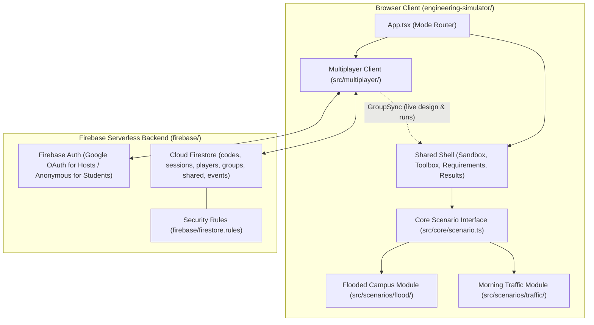

# BESA Engineering Lab

**BESA Engineering Lab** is an interactive, browser-based 3D engineering sandbox built for high-school outreach by the **Baskin Engineering Student Ambassadors (BESA)** at UC Santa Cruz.

In a live classroom or workshop setting, small teams of students get 10–15 minutes to design, test, fail, and iterate on civil and environmental engineering problems until their design meets measurable requirements within a fixed budget.

- **Live Production App:** [besachallenge.vercel.app](https://besachallenge.vercel.app)
- **Frontend App:** [`engineering-simulator/`](./engineering-simulator/README.md)
- **Backend & Multiplayer Architecture:** [`firebase/`](./firebase/README.md)
- **Scenario Specifications:**
  - [Scenario 1: Flooded Campus (`docs/specs/flooded-campus.md`)](./docs/specs/flooded-campus.md)
  - [Scenario 2: Morning Traffic (`docs/specs/morning-traffic.md`)](./docs/specs/morning-traffic.md)
  - [Scenario 3: Rocket Team (`docs/specs/rocket-team.md`)](./docs/specs/rocket-team.md)

---

## Core Design Principles

1. **No Single Correct Answer:** *"Engineering is not finding THE correct answer. Engineering is designing a solution that satisfies requirements under constraints."* Every challenge is tuned so multiple distinct engineering strategies pass within budget.
2. **Fact-Only Observations:** Post-test results report strictly factual measurements (e.g., *"Building B had the deepest flooding: 4.7 in"* or *"Cars were queued back onto Main Street for 14 minutes"*), never prescriptive advice (never *"Add a drain near Building B"*).
3. **Budget Never Blocks Placement:** Students can exceed the budget while experimenting; going over budget simply fails the cost requirement when evaluated.
4. **Fast, Deterministic Iteration:** Simulations run headlessly in pure TypeScript with a seeded RNG and play back visually in ~20 seconds in a tabletop 3D world.

---

## Repository Structure

```text
SequoiaSimulator/
├── README.md                     # Project overview, architecture & quickstart (this file)
├── CLAUDE.md                     # Contributor & agent guidelines, design principles
├── firebase.json                 # Firebase CLI configuration (Firestore rules, indexes, emulators)
├── .firebaserc                   # Firebase project mapping (`sequoia-eng-lab`)
├── docs/
│   ├── specs/                    # Source-of-truth engineering specs for each scenario
│   │   ├── flooded-campus.md     # Stormwater & runoff challenge specification
│   │   └── morning-traffic.md    # Transportation & street redesign specification
│   └── prompts/                  # Kickoff prompts for each scenario build phase
├── firebase/
│   ├── README.md                 # Backend data model, security rules & multiplayer flow docs
│   ├── firestore.rules           # Firestore security rules for sessions, codes, players, groups
│   └── firestore.indexes.json    # Firestore composite index definitions
└── engineering-simulator/        # Frontend Vite + React 19 + TypeScript + Three.js application
    ├── README.md                 # Detailed frontend & simulation engine documentation
    ├── package.json              # Scripts and dependencies
    ├── vite.config.ts            # Vite bundler & Vitest unit test config
    ├── vitest.emulator.config.ts # Vitest config for Firebase Emulator security/flow tests
    └── src/
        ├── main.tsx              # React DOM root
        ├── App.tsx               # Top-level router (StartScreen, Solo Sandbox, StudentFlow, HostFlow)
        ├── index.css             # Tailwind CSS & custom theme tokens (forest, paper, mint, rust)
        ├── core/                 # Scenario-agnostic contracts (Scenario<O,R>, undo history, formatting)
        ├── shell/                # Shared UI chrome (Sandbox, Toolbox, RequirementsPanel, ResultsModal)
        ├── shared/three/         # Shared 3D utilities (CameraRig, DOM-projected 3D Labels)
        ├── scenarios/            # Pluggable engineering scenarios
        │   ├── registry.ts       # Active scenario registry
        │   ├── flood/            # Scenario 1: Flooded Campus (2D shallow-water grid sim + 3D world)
        │   └── traffic/          # Scenario 2: Morning Traffic (agent lane-network sim + 3D world)
        └── multiplayer/          # Firebase Auth, Firestore real-time sync, team builder & UI flows
```

---

## System Architecture



### Separation of Concerns
* **Scenario-Agnostic Shell (`src/shell/`, `src/core/`):** Handles layout, tool selection, undo/redo history, live budget tracking, requirement status checklists, simulation playback controls, and results modals without importing any scenario-specific code.
* **Pure TypeScript Simulation Engines (`src/scenarios/*/sim/`):** Completely decoupled from React, Three.js, and the DOM. They can execute an entire simulation headlessly in `< 1–2 seconds` for automated Vitest balancing tests (`npm test`).
* **Serverless Real-Time Multiplayer (`src/multiplayer/`, `firebase/`):** Uses Firebase Authentication and Cloud Firestore with zero custom backend servers. Single-player mode works completely client-side without requiring network access.

---

## Quickstart

All frontend and test commands run from the [`engineering-simulator/`](./engineering-simulator/) directory:

```bash
cd engineering-simulator
npm install
```

### Development & Building
| Command | Description |
| :--- | :--- |
| `npm run dev` | Start the local Vite development server |
| `npm run build` | Run TypeScript type-checking (`tsc -b`) and build production bundle |
| `npm run lint` | Run ESLint across the codebase |
| `npm test` | Run headless simulation physics & strategy balancing tests (Vitest) |
| `TUNE=1 npx vitest run tune` | Print full strategy balancing tables for Flooded Campus and Morning Traffic |

### Local Multiplayer & Emulator Testing
Running multiplayer against the local Firebase Emulators requires Java 21+ on your `PATH`:

```bash
# Terminal 1: Start Firebase Auth & Firestore emulators
cd engineering-simulator
npm run emulators

# Terminal 2: Start Vite connected to local emulators
cd engineering-simulator
npm run dev:mp

# Or run the automated multiplayer & Firestore security rules test suite:
npm run test:mp
```

### URL Shortcuts
* `?play` or `?play=flood` / `?play=traffic` — Skip the start screen and jump directly into a solo scenario without the intro modal.
* `?join=123456` — Open the student join screen with the 6-digit session code pre-filled.
* `?host` — Open the instructor session hosting dashboard.
* `?debug` (or press `Shift+D` in-game) — Toggle debug overlays (grid coordinates, elevations, lane/site IDs).

---

## Detailed Documentation Index

* **[Frontend & Simulation Architecture (`engineering-simulator/README.md`)](./engineering-simulator/README.md)** — Detailed breakdown of every frontend directory, key files, the `Scenario` interface, 3D rendering rules, and how to create or tune scenarios.
* **[Backend & Multiplayer Architecture (`firebase/README.md`)](./firebase/README.md)** — Detailed walkthrough of the Firestore schema, security rules, authentication models, team-matching algorithm, and real-time synchronization.
