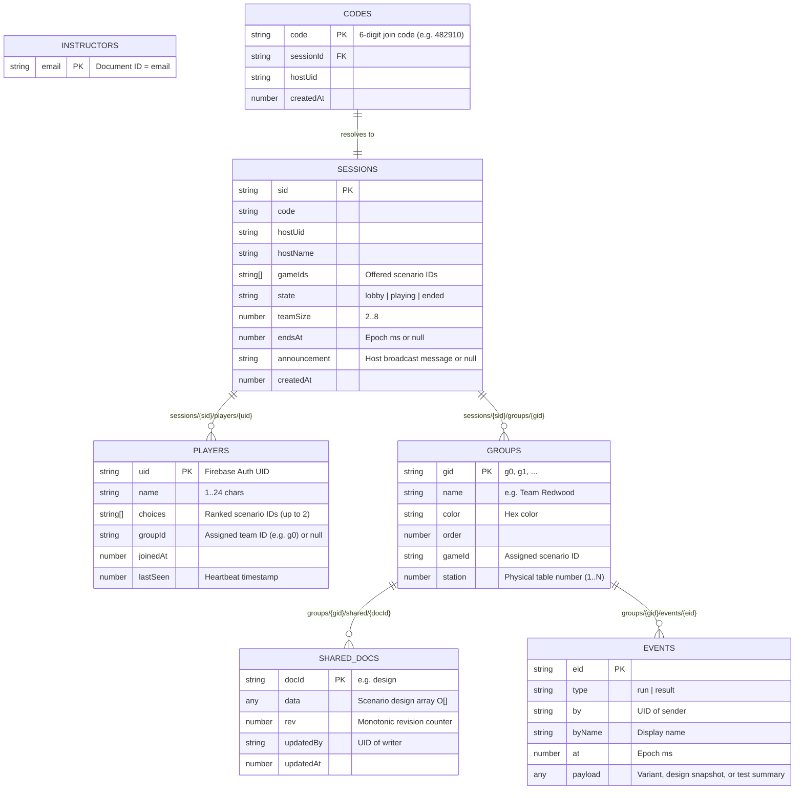
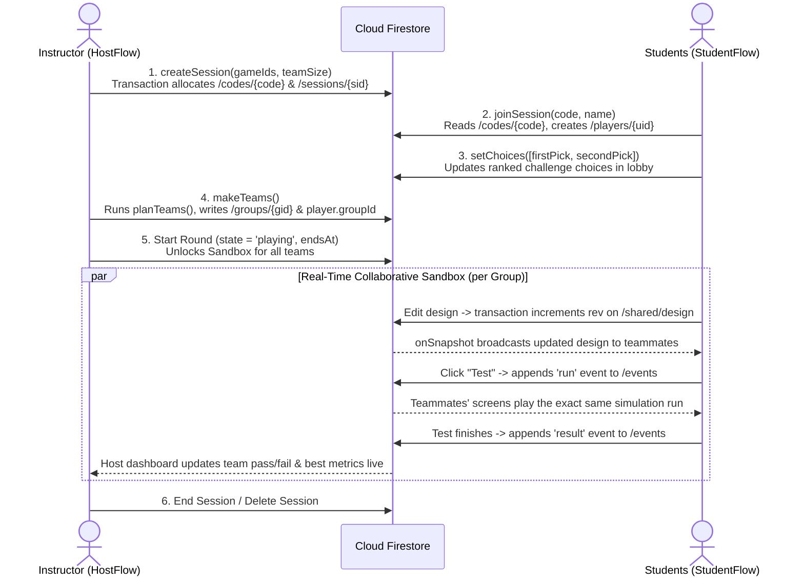

# BESA Engineering Lab — Backend & Multiplayer Architecture

The backend for **BESA Engineering Lab** is a serverless Firebase architecture (project ID: `sequoia-eng-lab`, running on the free Spark plan) powered by **Firebase Authentication** and **Cloud Firestore**. There are no custom backend servers, Express apps, or Cloud Functions; all business logic, permission enforcement, and real-time synchronization happen via Firestore transactions, snapshot listeners, and security rules.

---

## Important Backend & Multiplayer Files

| File | Location | Purpose |
| :--- | :--- | :--- |
| [`firestore.rules`](./firestore.rules) | `firebase/` | Firestore security rules enforcing instructor verification, session ownership, student join/choice validation, and group-scoped writes. |
| [`firestore.indexes.json`](./firestore.indexes.json) | `firebase/` | Composite index definitions for Firestore queries. |
| [`firebase.json`](../firebase.json) | Root | Firebase CLI config pointing to rules/indexes and defining local Auth (`:9099`) & Firestore (`:8080`) emulator ports. |
| [`firebase.ts`](../engineering-simulator/src/multiplayer/firebase.ts) | `src/multiplayer/` | Client SDK initialization, emulator connection toggle (`VITE_USE_EMULATORS=1`), Google OAuth for instructors, and anonymous sign-in for students. |
| [`types.ts`](../engineering-simulator/src/multiplayer/types.ts) | `src/multiplayer/` | TypeScript definitions for all Firestore document shapes (`Session`, `Player`, `Group`, `SharedDoc`, `GroupEvent`). |
| [`api.ts`](../engineering-simulator/src/multiplayer/api.ts) | `src/multiplayer/` | Transactional & batch Firestore operations (`createSession`, `joinSession`, `setChoices`, `makeTeams`, `pushShared`, `addEvent`, etc.). |
| [`teams.ts`](../engineering-simulator/src/multiplayer/teams.ts) | `src/multiplayer/` | Pure team-formation and room-station assignment algorithm (`planTeams`, `placeLate`). |
| [`hooks.ts`](../engineering-simulator/src/multiplayer/hooks.ts) | `src/multiplayer/` | Real-time `onSnapshot` React hooks (`useSession`, `usePlayers`, `useGroups`, `useShared`, `useEvents`). |
| [`api.emulator.test.ts`](../engineering-simulator/src/multiplayer/api.emulator.test.ts) | `src/multiplayer/` | End-to-end Vitest suite testing multiplayer flows and security rules against the local Firebase Emulators. |

---

## Authentication & Roles

1. **Instructors (Hosts):**
   - Sign in with **Google OAuth** (`google.com` provider).
   - Verified by [`isInstructor()`](./firestore.rules) in `firestore.rules`: must have `email_verified == true` and either a `@ucsc.edu` email address or an entry in the `/instructors/{email}` allow-list collection.
   - Only instructors can create sessions, allocate 6-digit join codes, generate teams, change session states (`lobby` → `playing` → `ended`), or broadcast announcements.

2. **Students (Players):**
   - Sign in **anonymously** (`signInAnonymously`) when joining a session—no accounts, passwords, or personal emails required.
   - Identified by their Firebase `uid`.

---

## Firestore Data Model

All collections are **scenario-agnostic** so the backend works identically across Flooded Campus, Morning Traffic, and future challenges.



---

## Multiplayer Session Lifecycle



### 1. Lobby & Ranked Challenge Picks
- The instructor selects which scenarios are offered (`gameIds`) and target `teamSize` (2–8).
- `createSession` runs a Firestore transaction to claim an unused 6-digit code in `/codes/{code}` and create `/sessions/{sid}` in `state: 'lobby'`.
- Students enter the 6-digit code and their display name, creating `/sessions/{sid}/players/{uid}`.
- If multiple challenges are offered, students rank their top choices (`choices: string[]`, up to 2).

### 2. Team Formation & Station Assignment (`src/multiplayer/teams.ts`)
- When the instructor clicks **Make Teams**, `makeTeams()` runs `planTeams(players, gameIds, teamSize)`:
  - Bucketizes students into their highest-ranked available challenge.
  - Balances small remainder buckets so no student is stranded alone when another challenge can absorb them.
  - Splits each challenge bucket into balanced teams (`Team Redwood`, `Team Oak`, etc.) and assigns physical classroom table numbers (`station: 1, 2, ...`).
- Late-joining students can be placed into the smallest existing team via `placeLate()`.

### 3. Live Collaborative Design & Synchronized Runs (`GroupSync`)
During `state: 'playing'`, every student in a group renders `<Sandbox sync={groupSync} />`:
- **Shared Design (`groups/{gid}/shared/design`):**
  - When a student places, edits, or deletes an object, `pushDesign` runs a transaction incrementing `rev` and saving `{ data: design, rev, updatedBy, updatedAt }`.
  - Teammates receive the snapshot via `useShared`, ignore echoes of their own writes (`updatedBy === me`), and update their local canvas in real time.
- **Synchronized Test Playback (`groups/{gid}/events/{eid}`):**
  - When any teammate clicks **Run Test**, an append-only `run` event (`{ type: 'run', payload: { variantId, design } }`) is written to `events`.
  - Every teammate's device receives the event and starts the deterministic simulation simultaneously so the whole table watches the test together.
  - When the run finishes, the initiating client posts a `result` event (`{ type: 'result', payload: { variantId, pass, summary, cost } }`), which updates the group's feed and the instructor's live leaderboard.

---

## Security Rules Summary (`firebase/firestore.rules`)

- **`/instructors/{email}`**: Read-only by the authenticated user with that email; never writable from the client (managed via Firebase Console).
- **`/codes/{code}`**: Any signed-in user can `get` a single code (`list` is forbidden so codes cannot be scraped). Only verified instructors can `create` a code; only the owning host can `delete` it.
- **`/sessions/{sid}`**: Readable by any signed-in user who knows `sid`. Only verified instructors can `create` a session, and only the session's `hostUid` can `update` or `delete` it.
- **`/sessions/{sid}/players/{uid}`**: Students can only create/update their own document (`request.auth.uid == uid`), can only modify `['name', 'lastSeen', 'choices']` with valid lengths and offered `gameIds`, and cannot assign themselves to a `groupId` (only the host can write `groupId`).
- **`/sessions/{sid}/groups/{gid}/shared/{doc}`**: Writable only by the session host or a player who is currently assigned to `gid` (`inGroup(sid, gid)`) while `session.state == 'playing'`.
- **`/sessions/{sid}/groups/{gid}/events/{eid}`**: Append-only (`create` allowed by group members or host; `update` and `delete` forbidden).

---

## Testing & Deployment

### Running Security Rule & Flow Tests Locally
Whenever you modify `firebase/firestore.rules` or `src/multiplayer/api.ts`, run the emulator test suite from `engineering-simulator/`:

```bash
cd ../engineering-simulator
npm run test:mp
```

*(Note: Requires Java 21+ on `PATH`, e.g. `export PATH=/opt/homebrew/opt/openjdk@21/bin:$PATH`.)*

### Deploying Firestore Rules to Production
From the repository root:

```bash
firebase deploy --only firestore:rules
```
